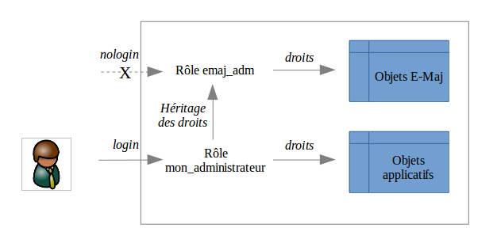

Mettre en place la politique d'accès à E-Maj
============================================

.. raw:: html

    

Une mauvaise utilisation d'E-Maj peut mettre en cause l'intégrité des bases de données. Aussi est-il recommendé de n'autoriser son usage qu'à des utilisateurs qualifiés et clairement identifiés comme tels.

Les rôles E-Maj
---------------

Pour utiliser E-Maj, on peut se connecter en tant que *SUPERUSER*. Mais pour des raisons de sécurité, il est préférable de tirer profit des deux rôles créés par la procédure d'installation :

* ``emaj_adm`` : le rôle d'administration d'E-Maj.

   * Il le propriétaire du schéma ``emaj`` et de tout ce qu'il contient (à l'exception des fonctions), ainsi que de tous les objets de log (schémas, tables, séquences, fonctions).
   * Il peut exécuter toutes les fonctions E-Maj.
* ``emaj_viewer`` : le rôle pour des accès en lecture seule.

   * Il ne peut exécuter que des fonctions de type informative ou statistique et n'accède aux tables d'E-Maj qu'en lecture.

Notons que :ref:`ces deux rôles peuvent ne pas exister<roles_limits>` si l’extension *emaj* a été installée par un rôle qui ne disposait pas des droits *SUPERUSER*.

A leur création, ces deux rôles ne possèdent **pas de capacité de connexion** (attribut *NOLOGIN* et aucun mot de passe). Il est recommandé de NE PAS leur attribuer cette capacité de connexion. A la place, il suffit d'attribuer les droits qu'ils possèdent à d'autres rôles par des requêtes SQL de type *GRANT*.

----

Attribution des droits E-Maj
----------------------------

Pour attribuer à un rôle donné tous les droits associés à l'un des deux rôles *emaj_adm* ou *emaj_viewer*, et une fois connecté en tant que *SUPERUSER*, il suffit d'exécuter l'une des commandes suivantes ::

  GRANT emaj_adm TO <mon.rôle.administrateur.emaj>;
  GRANT emaj_viewer TO <mon.rôle.de.consultation.emaj>;

Naturellement, plusieurs rôles peuvent se voir attribuer les droits *emaj_adm* ou *emaj_viewer*.

----

Attribution des droits sur les tables et objets applicatifs
-----------------------------------------------------------

Il n’est pas nécessaire d’attribuer aux rôles *emaj_adm* et *emaj_viewer* des droits particuliers sur les tables et séquences applicatives. Les fonctions qui nécessitent d’accéder à ces objets sont exécutées avec le rôle d’installation de l’extension *emaj*, c’est à dire un rôle de type *SUPERUSER*.

----

Synthèse
--------

Le schéma ci-dessous symbolise **l'attribution recommandée des droits** pour un administrateur E-Maj.

Bien évidemment, ce schéma s'applique également au rôle *emaj_viewer*.

Sauf indication contraire, les opérations qui suivent vont pouvoir être exécutées par tout rôle possédant les droits *emaj_adm*.
